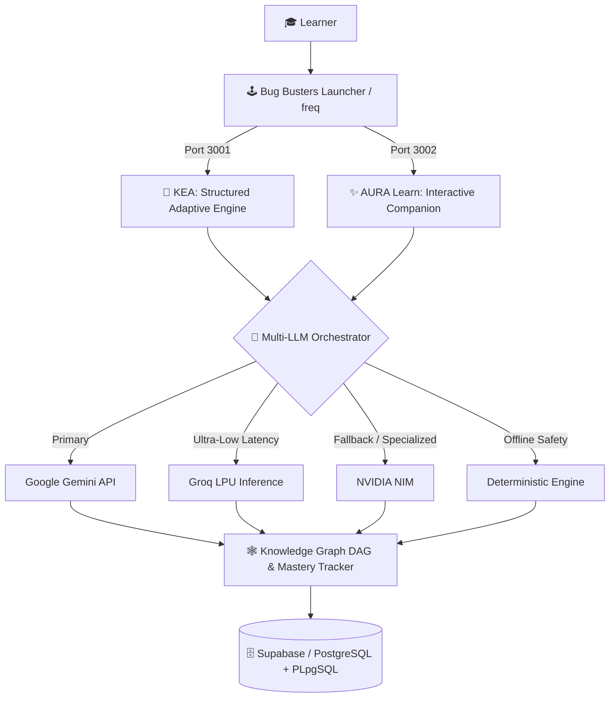

<div align="center">

  <!-- 🌌 DYNAMIC ANIMATED HEADER -->
  <a href="https://github.com/vats1126">
    
  </a>

  <p align="center">
    
  </p>

  <p align="center">
    <b>Student &amp; Full-Stack AI Builder from Karnataka, India 🇮🇳</b><br/>
    <i>Architecting adaptive AI learning platforms, shipping hackathon MVPs end-to-end, and exploring Open Source.</i>
  </p>

  <!-- 🏷️ LIVE STATUS & SOCIAL BADGES -->
  <p align="center">
    <a href="https://github.com/vats1126">
      
    </a>
    <a href="https://github.com/vats1126?tab=followers">
      
    </a>
    <a href="https://bug-busters-launcher.vercel.app/">
      
    </a>
  </p>

</div>

---

## ⚡ Quick Terminal (`whoami`)

```yaml
developer:
  name: "VATS"
  handle: "@vats1126"
  location: "Karnataka, India 🇮🇳"
  team_alias: "Bug Busters 🐛🔨"

focus_areas:
  - "AI + EdTech (Adaptive Learning & Real-Time Intervention)"
  - "Multi-LLM Orchestration (Gemini, Groq, NVIDIA NIM)"
  - "Full-Stack Web Engineering (Next.js, TypeScript, Supabase)"
  - "Open Source & GSoC Preparation"

current_mission: "Shipping AI-native tools that adapt to how humans actually learn."
```

---

## 🏆 Hackathon Trophy Room

<table width="100%">
  <tr>
    <td width="50%" valign="top">
      <h3>🥇 1st Place — HackMysuru 1.0</h3>
      <p><b>Track:</b> Phase 2, Problem 01 — <i>Adaptive Learning &amp; Real-Time Intervention Platform</i></p>
      <ul>
        <li>Led team <b>Bug Busters (HM26-1E71)</b> to 1st place.</li>
        <li>Engineered <b>KEA ❤️ AURA Learn</b>: a dual-MVP adaptive learning ecosystem with a deterministic mastery engine, DAG knowledge graphs, and multi-LLM fallback routing.</li>
      </ul>
    </td>
    <td width="50%" valign="top">
      <h3>🥇 1st Place — Prompt Arcade</h3>
      <p><b>Venue:</b> Game Development Hackathon @ <i>Christ University, Kengeri</i></p>
      <ul>
        <li>Secured the <b>#1 spot</b> in a competitive prompt-driven game development sprint.</li>
        <li>Designed rapid AI-assisted game mechanics, interactive loops, and shippable gameplay under strict time constraints.</li>
      </ul>
    </td>
  </tr>
</table>

---

## 🚀 Flagship Builds & Interactive Architecture

### 🌟 1. KEA × AURA Learn — *Adaptive AI Learning Ecosystem*
> **🏆 1st Place Winner @ HackMysuru 1.0** | Two unified MVPs tackling real-time student intervention and personalized mastery.

<p>
  <a href="https://bug-busters-launcher.vercel.app/">
    
  </a>
  <a href="https://github.com/vats1126/HM26-1E71-submission">
    
  </a>
  <a href="https://github.com/vats1126/freq">
    
  </a>
</p>

- **KEA (Structured Mastery Engine):** Guides learners from topic discovery and prerequisite checks to dynamic study plans, assessments, and Knowledge-Graph (DAG) mastery tracking.
- **AURA Learn (Interactive Experience):** A visually immersive, voice-enabled (`Web Speech API`) companion built for high engagement and real-time intervention.
- **Resilient AI Layer:** Orchestrates **Google Gemini**, **Groq**, and **NVIDIA NIM** with strict structured-output validation and deterministic fallback so learning never breaks.

<details>
  <summary><b>🔍 Click to Expand: Interactive System Architecture (GitHub Mermaid Diagram)</b></summary>
  <br/>



</details>

---

### 🧩 More Repositories & Explorations

| Repository | What It Does | Stack & Focus | Link |
| :--- | :--- | :--- | :---: |
| 🧠 **`prompts`** | Curated personal vault of high-signal system prompts for coding, AI orchestration, and rapid prototyping. | `Prompt Engineering` `Markdown` `LLMs` | [View Repo](https://github.com/vats1126/prompts) |
| 🌍 **`gsoc-test`** | Sandbox repository for practicing clean Git/GitHub open-source contributor workflows (branching, PRs, rebasing). | `Git` `GitHub` `Open Source` | [View Repo](https://github.com/vats1126/gsoc-test) |

---

## 🛠️ Tech Arsenal

<div align="center">

  <!-- Visual Skill Icons -->
  <p>
    
  </p>

  <!-- Specialized AI & Architecture Badges -->
  <p>
    
    
    
    
    
    
  </p>

</div>

<details>
  <summary><b>⚡ Click to Inspect My Full Engineering Breakdown</b></summary>
  <br/>

  - **Frontend & UI Engineering:** Next.js (App Router & Route Handlers), React, TypeScript, Tailwind CSS, `shadcn/ui`, Lucide Icons, `next-themes`, Web Speech API.
  - **AI & LLM Systems:** Multi-model routing (Gemini, Groq, NVIDIA NIM), structured JSON schema validation, deterministic fallback engines, DAG-based adaptive learning algorithms.
  - **Backend & Database:** PostgreSQL, Supabase, custom `PLpgSQL` functions & triggers, RESTful API design.
  - **AI Developer Tooling:** Codex, Hermes, Google Antigravity, ChatGPT, Vercel CI/CD.

</details>

---

## 📊 Live GitHub Pulse

<div align="center">

  
  

  <br/>

  

</div>

---

## 🕹️ Interactive Developer Console

<details>
  <summary><b>💻 Click to run <code>npx vats1126 --connect</code></b></summary>
  <br/>

```bash
$ npx vats1126 --connect

✔ Loading profile for VATS (@vats1126)...
✔ Status: Open to Hackathon Teams, AI Collaborations & Open-Source Contributions!

  🚀 Try my live project  -->  https://bug-busters-launcher.vercel.app/
  ⭐ Star my flagship MVP -->  https://github.com/vats1126/HM26-1E71-submission
  🐙 Follow on GitHub     -->  https://github.com/vats1126
```

</details>

<div align="center">
  <br/>
  
  <p><i>Built with code, caffeine, and curiosity by <a href="https://github.com/vats1126">VATS</a> ⚡</i></p>
</div>
